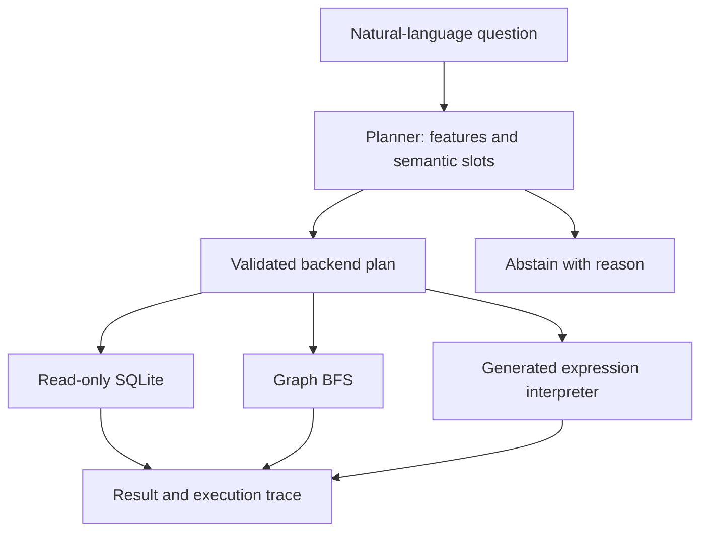

# PolyQuery

PolyQuery studies natural-language query routing across SQLite, graph traversal, and restricted Python statistical expressions.

```bash
python -m pip install -e .
polyquery query "What is the average salary in Engineering?"
polyquery query "Find the shortest path from Bob to Frank"
polyquery query "What is the median salary?"
polyquery evaluate --output benchmarks/latest.json
python -m unittest discover -s tests -v
```

Python 3.11+, no runtime dependencies, accounts, API keys, or network required. Run commands from the repository root. Without installing, use `python -m polyquery.cli` instead of `polyquery`.

## What works today

| Question | Selected backend | Execution artifact |
| --- | --- | --- |
| How many employees are in Engineering? | SQLite | Parameterized `COUNT(*)` |
| What is total revenue by department? | Unsupported in v0.1 | Abstention; grouped queries are not implemented |
| Total revenue for Sales | SQLite | Parameterized `SUM(amount)` |
| Shortest path from Bob to Frank | In-memory graph | BFS over undirected reporting edges |
| Who reports to Alice? | In-memory graph | All downstream reports, not only direct reports |
| Median salary in Research | Generated Python expression | `median(salary)` |
| Correlation between salary and experience | Generated Python expression | `correlation(salary, experience)` |
| Average salary and shortest path from Alice to Bob | Abstain | Split the request into separate questions |

The CLI returns the selected route, matching features, explanation, execution artifact, answer, and total query latency. Feature scores count rule matches; they are not probabilities.

## Scope and interpretation

The router uses keyword rules and extracts parameters for a fixed set of operations. The default dataset contains six synthetic employees and four sales entries. Graph queries run in memory; there is no Neo4j connection. The Python backend constructs statistical expressions and interprets them through an AST allowlist. It does not run arbitrary programs.

Supported operations: employee count/list, mean salary, total revenue, relationship paths, downstream reports, salary median/sample standard deviation, and Pearson salary/experience correlation. SQL and univariate statistics accept one known department filter. Correlation and graph traversal do not support department filters. Unsupported and mixed intents abstain. Some unknown modifiers can still evade the heuristic detector; use the supported examples rather than treating this as a semantic correctness guarantee.

The research question is whether routing improves correctness, latency, or cost over a capable fixed backend. Recursive SQL can answer graph questions, and SQL can compute statistics, so comparisons need equivalent operations on the same data.

## Architecture

### Selectable LDBC source

The synthetic source remains the default. The LDBC loader reads pipe-delimited
CsvBasic person and knows files, validates unique person IDs and edge endpoints,
and builds an undirected in-memory friendship projection. Duplicate friendships
collapse; IDs are returned as strings, preserving large identifiers. Names are
display attributes; queries use IDs to avoid ambiguous names.

From the `polyquery` directory in VS Code's terminal:

```powershell
python -m polyquery.cli inspect-source --people benchmarks/people_0_0.csv --knows benchmarks/person_knows_person_0_0.csv
python -m polyquery.cli query "How many people?" --source ldbc --people benchmarks/people_0_0.csv --knows benchmarks/person_knows_person_0_0.csv
python -m polyquery.cli query "Friends of 933" --source ldbc --people benchmarks/people_0_0.csv --knows benchmarks/person_knows_person_0_0.csv
python -m polyquery.cli query "Shortest path from 933 to 2199023256077" --source ldbc --people benchmarks/people_0_0.csv --knows benchmarks/person_knows_person_0_0.csv
```

Paths are explicit: `people_0_0.csv` is the local filename; the usual
`person_0_0.csv` works too. Only the supplied files are loaded; this does not
establish completeness of the SF0.1 distribution. Counts, friend lists, and
shortest paths use an exact supported grammar; other questions abstain.
Disconnected paths return `null`. Load time is excluded from query latency.
This source currently offers only the graph adapter, so it cannot yet measure
routing improvements against capable fixed-backend baselines. `evaluate` remains
the synthetic development evaluation.

Chinook SQLite and taxi Parquet were found locally but are not integrated yet.
Keep downloaded raw datasets local; the tests use small temporary fixtures and
do not require downloads. No held-out research results are claimed.



Alternative planners implement the `Planner` protocol and return a `Plan`. Backends validate operations and parameters before execution. The current planner runs locally without model calls.

## Evaluation

`benchmarks/demo.json` contains 31 development regression cases covering routes, answers, filters, ambiguity, and abstention. The evaluator reports route accuracy, joint route/answer accuracy, coverage, answered accuracy, abstention precision, a confusion matrix, and a fixed SQL route-label baseline. Numeric answers are compared with tolerance. `benchmarks/latest.json` stores a previous run.

High accuracy on these template-driven cases is a functional check, not a generalization result. The SQL-only comparison measures route labels only, not an optimized SQL system's answer accuracy. See [research plan](docs/research.md) for held-out evaluation and fair backend comparisons.

## Execution boundaries

SQL is generated from fixed templates with bound values; query-only mode and an authorizer deny writes. The generated expression interpreter accepts only a single allowlisted statistical function applied to bounded numeric vectors. It uses neither `eval` nor `exec`. These restrictions apply to the built-in fixture, not arbitrary third-party plugins. The system is not a general untrusted-code sandbox or a production service.

References: [Python SQLite API](https://docs.python.org/3/library/sqlite3.html), [SQLite authorization](https://www.sqlite.org/c3ref/set_authorizer.html), [Python statistics](https://docs.python.org/3/library/statistics.html).

## Next milestones

- Schema-aware typed plans and explicit backend capability/cost catalogs.
- Real PostgreSQL and Neo4j adapters over equivalent datasets.
- Held-out paraphrases, unseen schemas, and adversarial queries labeled independently.
- Trained/LLM router compared with keyword, SQL-only, random, and oracle baselines.
- Multi-stage plans such as graph traversal → relational lookup → statistical analysis.
- Container isolation and resource limits before expanding to arbitrary generated code.

See [CONTRIBUTING.md](CONTRIBUTING.md) for reproducible checks.
