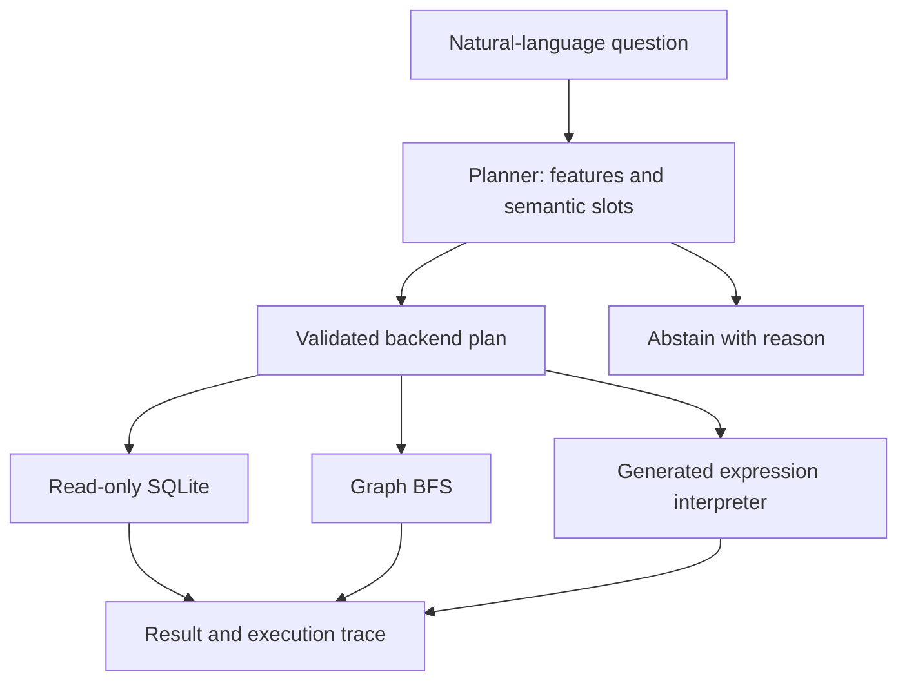

# 🧭 PolyQuery

**Route a question to the computation it needs.** PolyQuery is a runnable research baseline for natural-language routing across relational SQL, graph traversal, and constrained generated Python expressions.

```bash
python -m pip install -e .
polyquery query "What is the average salary in Engineering?"
polyquery query "Find the shortest path from Bob to Frank"
polyquery query "What is the median salary?"
polyquery evaluate --output benchmarks/latest.json
python -m unittest discover -s tests -v
```

Python 3.11+, no runtime dependencies, accounts, API keys, or network required. Run commands from the repository root. Without installing, use `python -m polyquery.cli` instead of `polyquery`.

## What works today

| Question | Selected backend | Execution artifact |
| --- | --- | --- |
| How many employees are in Engineering? | SQLite | Parameterized `COUNT(*)` |
| What is total revenue by department? | Unsupported in v0.1 | Abstention; grouped queries are not implemented |
| Total revenue for Sales | SQLite | Parameterized `SUM(amount)` |
| Shortest path from Bob to Frank | In-memory graph | BFS over undirected reporting edges |
| Who reports to Alice? | In-memory graph | All downstream reports, not only direct reports |
| Median salary in Research | Generated Python expression | `median(salary)` |
| Correlation between salary and experience | Generated Python expression | `correlation(salary, experience)` |
| Average salary and shortest path from Alice to Bob | Abstain | Split the request into separate questions |

The CLI returns the route, feature scores, rationale, executable artifact, result, and planning/execution latency. Scores are feature counts, **not confidence probabilities**.

## Scope and interpretation

This is a **deterministic, bounded keyword-and-slot baseline**, not a trained router or a general text-to-SQL system. The fixtures contain six synthetic employees and four sales entries. No proprietary data is included. The graph adapter is an in-memory adjacency graph, **not a connection to Neo4j**. Code generation emits a small statistical expression; arbitrary programs are not supported.

Supported operations: employee count/list, mean salary, total revenue, relationship paths, downstream reports, salary median/sample standard deviation, and Pearson salary/experience correlation. SQL and univariate statistics accept one known department filter. Correlation and graph traversal do not support department filters. Unsupported and mixed intents abstain. Some unknown modifiers can still evade the heuristic detector; use the supported examples rather than treating this as a semantic correctness guarantee.

The interesting research question is whether a schema-aware router can select an efficient execution strategy while preserving answer correctness. This prototype makes that hypothesis testable; it does not establish that graph questions cannot be answered using recursive SQL or that statistics require Python.

## Architecture



`Planner` is a protocol: swap the baseline for a trained or LLM planner returning a `Plan`. Adapter validation still rejects unknown operations, parameters, departments, and graph nodes. No LLM integration is enabled in v0.1.

## Evaluation

`benchmarks/demo.json` is an explicit **development regression set** covering routes, answers, filters, ambiguity, and abstention. The evaluator reports route accuracy, joint route/answer accuracy, coverage, answered accuracy, abstention precision, a confusion matrix, and a fixed SQL route-label baseline. It compares numeric answers with tolerance. `benchmarks/latest.json` contains an actual local run.

High accuracy on these template-driven cases is a functional check, not a generalization result. The SQL-only comparison measures route labels only, not an optimized SQL system's answer accuracy. See [research plan](docs/research.md) for held-out evaluation and fair backend comparisons.

## Execution boundaries

SQL is generated from fixed templates with bound values; query-only mode and an authorizer deny writes. The generated expression interpreter accepts only a single allowlisted statistical function applied to bounded numeric vectors. It uses neither `eval` nor `exec`. These restrictions apply to the built-in fixture, not arbitrary third-party plugins. The system is not a general untrusted-code sandbox or a production service.

References: [Python SQLite API](https://docs.python.org/3/library/sqlite3.html), [SQLite authorization](https://www.sqlite.org/c3ref/set_authorizer.html), [Python statistics](https://docs.python.org/3/library/statistics.html).

## Next milestones

- Schema-aware typed plans and explicit backend capability/cost catalogs.
- Real PostgreSQL and Neo4j adapters over equivalent datasets.
- Held-out paraphrases, unseen schemas, and adversarial queries labeled independently.
- Trained/LLM router compared with keyword, SQL-only, random, and oracle baselines.
- Multi-stage plans such as graph traversal → relational lookup → statistical analysis.
- Container isolation and resource limits before expanding to arbitrary generated code.

See [CONTRIBUTING.md](CONTRIBUTING.md) for reproducible checks.

