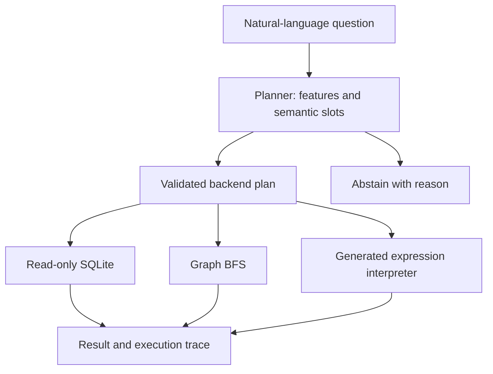

# PolyQuery

PolyQuery studies natural-language query routing across SQLite, graph traversal, and restricted Python statistical expressions.

The [constraint-preservation guard](docs/constraint-preservation.md) checks known
filters and modifiers before execution and records blocked plans. It is a
conservative lexical check, not a semantic correctness guarantee.

[Canonical constraints](docs/canonical-constraints.md) add typed predicates,
plan-preservation validation, an offline extraction benchmark, and optional Jev
constraint classification. Classification never overrides execution validation.

The [expanded label review](docs/constraint-labeling.md) covers 160 draft questions
in 40 families, with leakage-grouped split proposals and an independent-review
packet. These are not yet approved held-out research labels.

```bash
python -m pip install -e .
polyquery query "What is the average salary in Engineering?"
polyquery query "Find the shortest path from Bob to Frank"
polyquery query "What is the median salary?"
polyquery evaluate --output benchmarks/latest.json
python -m unittest discover -s tests -v
python -m pytest -q
```

Python 3.11+. The default synthetic source has no runtime dependencies and runs offline. Run commands from the repository root. Without installing, use `python -m polyquery.cli` instead of `polyquery`.

Real-data benchmarks support Chinook, LDBC person/knows, and the full supplied
Taxi Parquet file, including fixed-backend execution comparisons. Taxi requires
the optional `.[taxi]` dependency. See [real-data benchmark commands](docs/real-data-benchmarks.md)
and [evaluation metrics](docs/evaluation.md).

The [challenge evaluation](docs/challenge-evaluation.md) adds disjoint operation
families, paraphrases, compound requests, and a cost policy calibrated only on
training data. It reports coverage and execution regret alongside accuracy.

[Planner contracts](docs/planner-contracts.md) define typed operation parameters,
result shapes, entity identity, schemas, and capability/cost catalogs. Inspect
them with `python -m polyquery.cli describe-source`.

[Optional SQL Server support](docs/sqlserver.md) runs five Chinook aggregates
through the existing SQL operation contracts.

The [Chinook scale benchmark](docs/chinook-scale.md) verified 32 workload and
selectivity combinations on SQLite and SQL Server from 1× to 1,000×. In the
local, warm-connection run, SQLite was faster in all eight 1× cases. At
1,000×, the broad five-table join had a query p50 of 8,531 ms on SQLite and
467 ms on SQL Server. The broad high-cardinality aggregation remained
inconclusive. The crossover warrants testing a routing policy against fixed
backends on held-out workloads.

The [held-out physical routing experiment](docs/physical-routing.md) found
that SQLite won all six 1x cases and SQL Server won five of six at 1,000x.
The opt-in router agreed with the measured oracle on 19 of 24 cases.
Summed end-to-end case medians yielded 6.14x speedup over fixed SQLite and
1.037x over fixed SQL Server in this local, warm-connection run. At 10x,
both fixed backends beat the router by the same measure. SQLite remains
the production default.

The [M7.1 physical routing benchmark](docs/m7-physical-routing.md) tested
new 25x and 250x Chinook workloads and reviewed LDBC DAGs. Learned and
heuristic routing chose the same backends and completed all 60 warm and
24 cold trials. Fixed SQL Server timed out on 14 trials. The learned
policy added 0.15 ms per warm trial versus the heuristic on this sample.

The [intelligent routing experiment](docs/intelligent-routing.md) feeds
verified Qwen3 4B plans to a learned physical selector. On 12 held-out
composition questions, no Qwen plan cleared verification, so the run
established no end-to-end routing gain. With reviewed reference plans,
the selector matched the measured oracle on 10 of 10 comparable backend
choices. [Measured results](benchmarks/intelligent-routing-summary.json)

### LDBC graph traversal benchmark

The benchmark loads Person and Knows from the same LDBC CSVs into indexed
SQL projections. Direct-neighbor queries use a join. Shortest paths use
cycle-safe recursive CTEs on SQLite and SQL Server, with an additional
SQL Server baseline that expands one hop at a time using a request-local
visited set. SQL Server execution is opt-in. Planner and routing defaults
remain unchanged.

| Backend | Correct cases completed | Shortest paths completed |
| --- | ---: | ---: |
| In-memory BFS | 51/51 | 38/38 |
| SQLite recursive CTE | 42/51 | 29/38 |
| SQL Server recursive CTE | 40/51 | 27/38 |
| SQL Server frontier | 45/51 | 32/38 |

All completed answers matched an independent reference derived from the CSVs.
The frontier recovered five paths that the SQL Server CTE could not complete.
Warm BFS had lower median DAG latency in every matched case. This measures
the traversal implementations on the tested graphs. [Setup and reproduction commands](docs/ldbc-sql-graph.md)

An [optional LLM planner](docs/llm-planner.md) maps natural-language questions to
catalog-validated plans. Enable it with `--planner llm --model MODEL_ID`; the
keyword baseline stays the default. Live runs require the `.[llm]` extra and an
`OPENAI_API_KEY` environment variable.

## LLM routing

An optional catalog-aware LLM planner supports paraphrases with validated structured
plans. Install `.[llm]`, set `OPENAI_API_KEY`, and use `--planner llm --model YOUR_MODEL_ID`.
Add `--llm-fallback keyword` for explicit fallback on provider or output failures.
See [setup, boundaries, and comparison commands](docs/llm-planner.md). Keyword routing
remains the offline default. Local
OpenAI-compatible models use `--llm-api chat --llm-base-url http://localhost:11434/v1`
and need no OpenAI SDK or API key. Add `--policy cost-aware --cost-profile PATH`
to select an execution backend from measured costs after LLM intent planning.

## What works today

| Question | Selected backend | Execution artifact |
| --- | --- | --- |
| How many employees are in Engineering? | SQLite | Parameterized `COUNT(*)` |
| What is total revenue by department? | Unsupported in v0.1 | Abstention; grouped queries are not implemented |
| Total revenue for Sales | SQLite | Parameterized `SUM(amount)` |
| Shortest path from Bob to Frank | In-memory graph | BFS over undirected reporting edges |
| Who reports to Alice? | In-memory graph | All downstream reports, not only direct reports |
| Median salary in Research | Generated Python expression | `median(salary)` |
| Correlation between salary and experience | Generated Python expression | `correlation(salary, experience)` |
| Average salary and shortest path from Alice to Bob | Abstain | Split the request into separate questions |

The CLI returns the selected route, matching features, explanation, execution artifact, answer, and total query latency. Feature scores count rule matches; they are not probabilities.

## Scope and interpretation

The default router uses keyword rules and extracts parameters for a fixed set of operations. The default dataset contains six synthetic employees and four sales entries. Graph queries run in memory; there is no Neo4j connection. The Python backend constructs statistical expressions and interprets them through an AST allowlist. It does not run arbitrary programs.

Supported operations: employee count/list, mean salary, total revenue, relationship paths, downstream reports, salary median/sample standard deviation, and Pearson salary/experience correlation. SQL and univariate statistics accept one known department filter. Correlation and graph traversal do not support department filters. Unsupported and mixed intents abstain. Some unknown modifiers can still evade the heuristic detector; use the supported examples rather than treating this as a semantic correctness guarantee.

The research question is whether routing improves correctness, latency, or cost over a capable fixed backend. Recursive SQL can answer graph questions, and SQL can compute statistics, so comparisons need equivalent operations on the same data.

## Architecture

### Opt-in DAG planning

```bash
python -m polyquery.cli query --planner dag "Count employees in Engineering; then what is the median salary in Sales?"
python -m polyquery.cli query --planner dag "Who reports to the first employee listed in Sales?"
python -m polyquery.cli compare-dag --repeats 20 --output logs/dag-dev-report.json
```

Select `planner_kind="dag"` in Python or `--planner dag` for a CLI query.
The response includes `decision.kind` with one of `single_plan`, `dag_plan`,
or `abstain`. A single plan uses the usual backend result. A DAG response includes
the backend envelopes under `steps` and the requested outputs under
`result.value`. Multiple outputs are returned in the requested order.

Separate two to five standalone questions with `; then`. Each stage passes the
existing lexical and canonical guards before any stage executes. The synthetic
source also supports the exact dependent pattern “Who reports to the first
employee listed in [department]?” It binds the graph input to the first SQL
row in name order and returns all downstream reports.

The paired [development benchmark](benchmarks/dag-dev.json) scores expected
answer values and abstentions against the unchanged keyword baseline.

| Development cases | Keyword correct | DAG correct |
| --- | ---: | ---: |
| Single requests | 5/5 | 5/5 |
| Standalone sequences | 0/4 | 3/4 |
| Dependent requests | 0/4 | 3/4 |
| Expected abstentions | 7/7 | 7/7 |
| Total | 12/20 | 18/20 |

The six gains came from newly answered multi-stage cases. Both planners missed
a valid dependent paraphrase outside the supported pattern and a standalone
sequence whose first clause was blocked by canonical validation in DAG mode.
These hand-authored cases exercise the synthetic fixture and the supported
grammar. The comparison measures development coverage. Generalization to
unseen phrasing and sources remains unmeasured.

The [held-out DAG evaluation](docs/dag-evaluation.md) compares the frozen
planners on 120 additional synthetic questions with paired confidence intervals.
The same harness can include Qwen3 4B with `--model`. Use `query --planner llm-dag`
to request a model-proposed DAG.

### Structured DAG execution

Use `Engine.execute_dag` to compose read-only operations from the active source's
catalog. Node declarations can appear in any order. A named `InputBinding` reads
an upstream result's `value` and can select a list index or a field in a row.

```python
from polyquery import DAGNode, Engine, InputBinding

with Engine() as engine:
    results = engine.execute_dag([
        DAGNode("reports", "graph", "descendants",
                bindings={"source": InputBinding("employees", (0, "name"))}),
        DAGNode("employees", "sql", "list", {"department": "Engineering"}),
    ])
    print(results["reports"]["value"])
```

Use `depends_on` for ordering alone. Results are keyed by node ID in execution
order and contain the usual backend result envelopes. The executor validates the
DAG before dispatch, then validates resolved parameters and each result. A node
can opt into immediate retries with `retries=N`. Only explicit transient backend
errors and SQLite busy or locked errors are retried. Execution stops at the
first failure. `DAGExecutionError` records the node ID, failure stage, and attempt
count. Natural-language queries continue to use `Engine.query` and its
constraint-preservation checks.

### Selectable LDBC source

The synthetic source remains the default. The LDBC loader reads pipe-delimited
CsvBasic person and knows files, validates unique person IDs and edge endpoints,
and builds an undirected in-memory friendship projection. Duplicate friendships
collapse; IDs are returned as strings, preserving large identifiers. Names are
display attributes; queries use IDs to avoid ambiguous names.

From the `polyquery` directory in VS Code's terminal:

```powershell
python -m polyquery.cli inspect-source --people benchmarks/people_0_0.csv --knows benchmarks/person_knows_person_0_0.csv
python -m polyquery.cli query "How many people?" --source ldbc --people benchmarks/people_0_0.csv --knows benchmarks/person_knows_person_0_0.csv
python -m polyquery.cli query "Friends of 933" --source ldbc --people benchmarks/people_0_0.csv --knows benchmarks/person_knows_person_0_0.csv
python -m polyquery.cli query "Shortest path from 933 to 2199023256077" --source ldbc --people benchmarks/people_0_0.csv --knows benchmarks/person_knows_person_0_0.csv
```

Paths are explicit: `people_0_0.csv` is the local filename; the usual
`person_0_0.csv` works too. Only the supplied files are loaded; this does not
establish completeness of the SF0.1 distribution. Counts, friend lists, and
shortest paths use an exact supported grammar; other questions abstain.
Disconnected paths return `null`. Load time is excluded from query latency.
This source supports graph BFS and SQLite frontier traversal over the same
projection. `evaluate` defaults to the synthetic suite; `compare` runs the
selected real-data suite across execution policies.

Chinook SQLite and Taxi Parquet are separate selectable sources.
Keep downloaded raw datasets local; the tests use small temporary fixtures and
do not require downloads. No held-out research results are claimed.



Alternative planners implement the `Planner` protocol and return a `Plan`. Backends validate operations and parameters before execution. The default keyword planner runs locally; the optional LLM planner calls OpenAI for plan selection.

## Evaluation

Use `compare-routers` for a paired keyword/LLM run over the expanded constraint
labels, including answer correctness, proposed-plan constraint preservation,
abstention, latency, and token-cost accounting. See [router comparison](docs/router-comparison.md)
for local commands, scoring denominators, and draft-label limitations. Keep run
reports under Git-ignored `logs/`.

`benchmarks/demo.json` contains 31 development regression cases covering routes, answers, filters, ambiguity, and abstention. The evaluator reports route accuracy, joint route/answer accuracy, coverage, answered accuracy, abstention precision, a confusion matrix, and a fixed SQL route-label baseline. Numeric answers are compared with tolerance. `benchmarks/latest.json` stores a previous run.

High accuracy on these template-driven cases is a functional check, not a generalization result. The SQL-only comparison measures route labels only, not an optimized SQL system's answer accuracy. See [research plan](docs/research.md) for held-out evaluation and fair backend comparisons.

## Execution boundaries

SQL is generated from fixed templates with bound values; query-only mode and an authorizer deny writes. The generated expression interpreter accepts only a single allowlisted statistical function applied to bounded numeric vectors. It uses neither `eval` nor `exec`. These restrictions apply to the built-in fixture, not arbitrary third-party plugins. The system is not a general untrusted-code sandbox or a production service.

References: [Python SQLite API](https://docs.python.org/3/library/sqlite3.html), [SQLite authorization](https://www.sqlite.org/c3ref/set_authorizer.html), [Python statistics](https://docs.python.org/3/library/statistics.html).

## Next milestones

- Expand the existing typed plans and backend capability/cost catalogs.
- Real PostgreSQL and Neo4j adapters over equivalent datasets.
- Held-out paraphrases, unseen schemas, and adversarial queries labeled independently.
- Evaluate the optional LLM router against keyword, fixed-backend, and oracle baselines on held-out questions.
- Multi-stage plans such as graph traversal → relational lookup → statistical analysis.
- Container isolation and resource limits before expanding to arbitrary generated code.

See [CONTRIBUTING.md](CONTRIBUTING.md) for reproducible checks.
